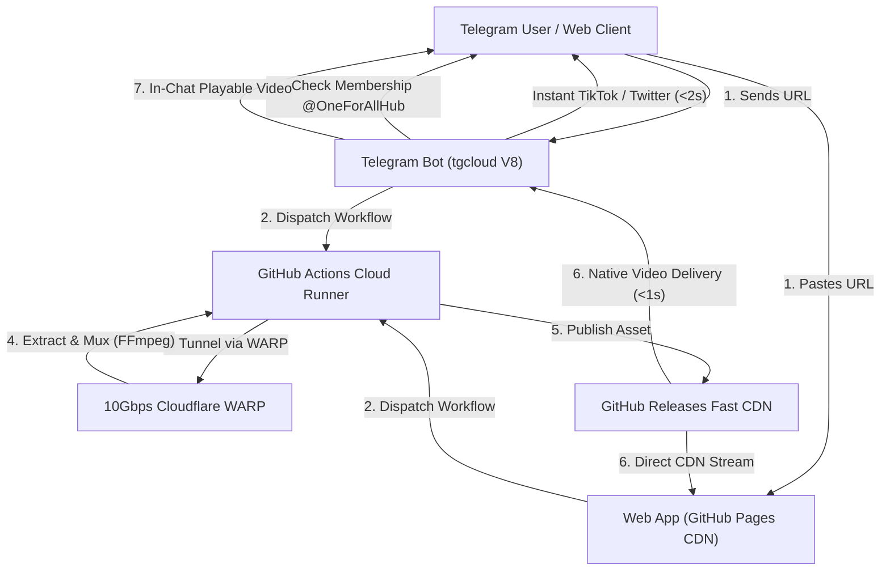

# ⚡ OneForAllHub — Universal Serverless Media Downloader

[](https://thehunterx.github.io/oneforall-media-downloader/)
[](https://t.me/OneForAllDownloaderBot)
[](https://t.me/OneForAllHub)
[](https://tgcloud.ai)
[](LICENSE)

> **OneForAllHub Media Downloader** is a high-performance, **100% serverless multi-platform media extraction engine**. Grab crystal-clear HD videos, watermark-free reels, and 192kbps MP3 tracks from **YouTube, TikTok, Twitter/X, Instagram, and Pinterest** in seconds — with **zero hosting costs, zero VPS maintenance, and unlimited bandwidth**.

---

## 🌟 Key Features

- ⚡ **Instant TikTok Engine:** Full HD 1080p video extraction with **zero watermark** in under **1.5 seconds**.
- 🐦 **Twitter / X Stream CDN:** Direct original-bitrate MP4 video download via ultra-low latency CDN pipes.
- 🔴 **YouTube Audio & Video Muxing:** True 1080p and 720p HD MP4 video with synced stereo audio (FFmpeg muxed) and studio-grade 192kbps MP3 extraction.
- 📸 **Instagram Reels & Posts:** Robust multi-tier extraction bypassing Meta rate limits via Cloudflare WARP.
- 🔒 **Mandatory Channel Membership:** Users must join [`@OneForAllHub`](https://t.me/OneForAllHub) to unlock unlimited high-speed downloads, featuring automated subscription verification.
- 👑 **Executive Admin Dashboard (`/admin`, `/stats`):** Dedicated real-time monitoring panel exclusively for **Authorized Admin**, tracking live member counts, delivery volume, and platform breakdown (YouTube, TikTok, Twitter, Instagram, Other).
- 🎬 **Native In-Chat Delivery:** Files under 18MB are delivered directly as **streamable, playable media files** natively inside Telegram chat.
- 🌐 **Modern SEO-Optimized Web Application:** Responsive Glassmorphism PWA built with Schema.org JSON-LD, OpenGraph cards, fast CDN caching, and one-click format conversion.

---

## 📊 Platform Capability Matrix

| Platform | Supported Formats | Engine Speed | In-Chat Delivery | Watermark |
| :--- | :--- | :--- | :--- | :--- |
| **TikTok** | 1080p HD MP4, MP3 Audio | `< 1.5s` (Instant) | ✅ Native Video | ❌ Watermark-Free |
| **Twitter / X** | Original HD MP4 (720p/1080p) | `< 2.0s` (Instant) | ✅ Native Video | ❌ None |
| **YouTube** | 1080p, 720p HD MP4, 192k MP3 | `~15 - 30s` (Muxed) | ✅ Native Video / CDN | ❌ None |
| **Instagram** | HD Reels, Video Posts, MP3 | `~15 - 35s` (WARP) | ✅ Native Video / CDN | ❌ None |
| **Pinterest** | Original MP4 Video, Pin Audio | `~15 - 30s` | ✅ Native Video / CDN | ❌ None |

---

## 🏗️ Architecture & Data Flow



---

## 👑 Executive Admin Dashboard

The bot administrator (@TheHunterX) has exclusive access to the built-in analytics dashboard.

### Available Commands:
- `/admin` or `/stats` — Displays live metrics:
  - 👥 **Total Tracked Users**
  - 🚀 **Total Successful Deliveries**
  - 📁 **Platform Breakdown:** YouTube, TikTok, Twitter/X, Instagram, Other
  - ⚡ **Infrastructure Health:** TGCloud V8 Isolate, Cloudflare WARP Tunnel, Direct Streaming status

> [!NOTE]
> Any non-admin user sending `/admin` receives no sensitive metrics. The admin user also automatically bypasses the mandatory channel join requirement.

---

## 🔒 Channel Subscription Enforcement

To grow your community, every user is required to join the official channel:
- **Channel:** [`https://t.me/OneForAllHub`](https://t.me/OneForAllHub) (`@OneForAllHub`)
- **Verification:** Users are prompted with a sleek locked card containing a `📢 Join @OneForAllHub` link and a `✅ Verify & Continue` callback button.
- **Fail-Open Protection:** If Telegram Bot API experiences a temporary timeout or network restriction, the check fails open to ensure zero downtime for your users.

---

## 🚀 Deployment & CI/CD

### 1. Telegram Serverless Bot (`tgcloud`)
The bot is 100% serverless, running inside Telegram's native V8 Cloud (`@tgcloud/cli`).
Deployment is fully automated upon pushes to `tgcloud/**` or manual dispatch via:
```bash
.github/workflows/deploy-tgcloud.yml
```

### 2. Cloud Media Downloader (`downloader.yml`)
Runs headless on Ubuntu runners with high-speed static FFmpeg binaries and automated Cloudflare WARP proxy tunneling (`wgcf` + `wireproxy`).

### 3. Web Application (`GitHub Pages`)
Hosted on GitHub Pages edge CDN:
- **Live URL:** [https://thehunterx.github.io/oneforall-media-downloader/](https://thehunterx.github.io/oneforall-media-downloader/)

---

## 🎨 Official Bot Profile & Branding

| Parameter | Configuration |
| :--- | :--- |
| **Bot Name** | `OneForAll Media Downloader` |
| **Username** | `@OneForAllDownloaderBot` |
| **About (<120 chars)** | `Fast & serverless media downloader. Grab videos from YouTube, TikTok (No Watermark), Twitter/X & Instagram in crystal HD.` |
| **Avatar** | [`assets/bot_avatar.jpg`](assets/bot_avatar.jpg) (High-Tech 3D Octane Render) |
| **Official Channel** | [`@OneForAllHub`](https://t.me/OneForAllHub) |

---

## 📄 License

This project is licensed under the [MIT License](LICENSE).
Created with ❤️ for **[@OneForAllHub](https://t.me/OneForAllHub)**.
